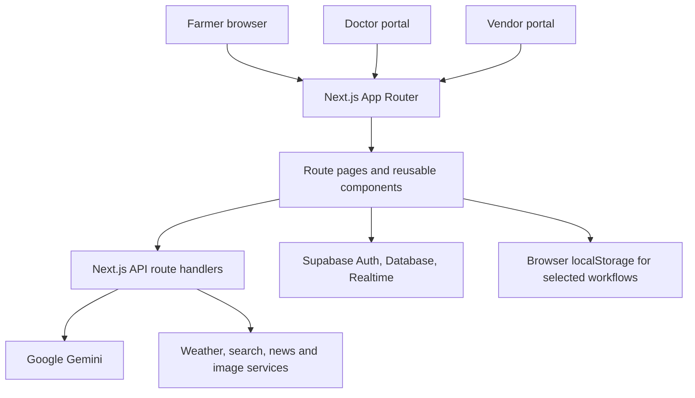
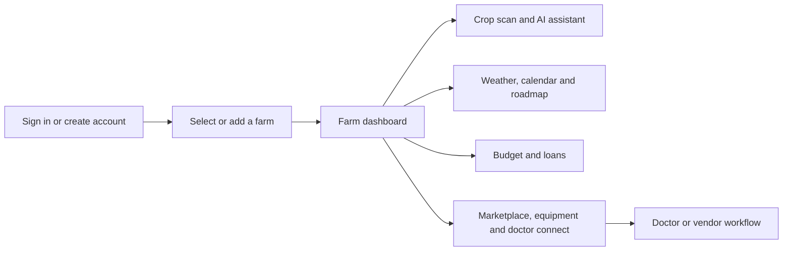

# FarmVeda

**Practical digital tools for planning, protecting, and managing a farm.**

FarmVeda is an agricultural web application for farmers and agricultural service providers. It brings farm records, crop health tools, weather, planning, financial workflows, local exchange, and expert discovery into one Next.js experience. Several workflows depend on configured external services; this README describes what the repository implements and calls out those dependencies.

[](https://nextjs.org/)
[](https://react.dev/)
[](https://www.typescriptlang.org/)
[](https://supabase.com/)

**Repository:** [pylarohit/farmveda](https://github.com/pylarohit/farmveda) · **Deployment listed by repository metadata:** [farmveda-jet.vercel.app](https://farmveda-jet.vercel.app)

> **Repository status:** The default `/` route in the current source is still the Next.js starter page. The farmer, farm, doctor, and vendor experiences are implemented under their application routes. The deployment link is provided by repository metadata and does not imply that every feature is configured or production-ready.

## Overview

Farmers often need to move between separate sources for crop advice, weather, farm planning, financing, equipment, buyers, and expert help. FarmVeda is designed to bring these workflows together in a single application. Farmers can create farm records, review weather and crop information, ask an AI assistant for guidance, manage planned activities and budgets, explore loans, list crops, find equipment, and connect with agricultural doctors. Doctor and vendor areas provide their own workflows.

The repository is a working product prototype with meaningful integrations and user flows. Some areas use Supabase and live APIs; others use local browser storage or fallback data. The project does not currently include a database schema/migration bundle, a complete deployment setup, or a verified set of product screenshots.

## The problem FarmVeda addresses

- **Fragmented information:** Farm and crop workflows can be spread across disconnected services.
- **Crop health awareness:** Farmers need a way to submit crop images and receive an initial disease assessment and next steps.
- **Planning under uncertainty:** Weather conditions, seasonal activities, and farm budgets affect decisions throughout a growing cycle.
- **Access to services:** Finding agricultural experts, equipment, financing, and buyers can be difficult.
- **Language access:** The app includes translation infrastructure and locale files for multiple Indian languages.

FarmVeda aims to make these workflows easier to reach. AI-generated recommendations are informational and should be checked with a qualified local agricultural professional before taking action.

## Features and implementation status

| Area | What the code provides | Status and dependencies |
| --- | --- | --- |
| Farm management | Create/select farm records and view a farm dashboard with associated planning and crop information. | Implemented; Supabase configuration and matching tables are required. |
| Crop health scan | Submit an image for Gemini-assisted crop disease analysis; save scan records and view scan history. | Implemented with external AI and Supabase dependencies. ImageKit is used for image upload paths. Results are guidance, not a verified diagnosis. |
| Disease detection route | A separate disease-detection page keeps scan history in browser local storage. | Implemented as a distinct local-only flow; it does not share persistence behavior with the Supabase-backed disease route. |
| Weather | Uses browser geolocation, Open-Meteo forecasts, reverse geocoding, and AI-assisted field advice. | Implemented; location permission and internet access are needed. |
| AI farming assistant | Chat endpoint backed by Gemini, with chat/search history stored in local storage. | Implemented; requires a server-side Gemini API key. |
| Farm feedback and roadmap | Gemini-generated feedback and crop/farm roadmaps; roadmaps can be saved to Supabase. | Implemented with external service and database configuration. |
| Farm calendar | Calendar events are stored in local storage; roadmap information can be loaded from Supabase. | Implemented; calendar event persistence is browser/device-specific. The route is spelled `calender` in the source. |
| Budget and loans | Budget transactions, farm budgets, loan records, and loan booking workflows. | Implemented against Supabase tables; service setup and policies are required. |
| Crop marketplace | Create/manage crop listings and vendor orders, with Supabase-first data access and local storage fallbacks. | Implemented; local fallback data is not shared between devices. |
| Equipment rent and hire | Browse/create rental listings and communicate through the app's messaging data. | Implemented with Supabase-backed records. |
| Doctor connect | Browse doctor records from `mentors`, book/connect through the messages workflow, and use doctor-specific pages. | Implemented; depends on configured Supabase data. Doctor demo/local authentication needs production hardening. |
| Video calls | Room page integrates the Zego UIKit. | Integration exists; credential handling must be redesigned before production (see [Security notes](#security-notes)). |
| Vendor portal | Vendor login and marketplace workflows. | UI and local/demo authentication paths exist; local storage is not secure authentication. |
| News, market prices, schemes, products, and crop videos | API routes connect to external data/search services; some endpoints return mock/fallback results when services fail or keys are missing. | Partially dependent on third-party credentials and availability. A fallback response is not live data. |
| Multilingual interface | Locale files and language switching/translation integration for English, Telugu, Hindi, Gujarati, Kannada, Punjabi, Malayalam, Marathi, Tamil, and Bengali. | Translation support exists; coverage varies by screen and some paths may fall back to dynamic translation. |

## Architecture

FarmVeda uses the Next.js App Router. Route pages compose React components, while server route handlers in `src/app/api` call AI and third-party services. Supabase client code handles database/auth workflows; some UI modules retain browser-local state for demo or offline-like behavior.



### Application workflows



## Technology stack

| Layer | Technologies verified in the repository |
| --- | --- |
| Web application | Next.js 16 App Router, React 19, TypeScript |
| Styling and components | Tailwind CSS 4, Radix UI, shadcn components, Lucide, Framer Motion/Motion |
| Data and authentication | Supabase JavaScript client and `@supabase/ssr` |
| AI integrations | Google Generative AI SDK; Gemini-backed API routes. LangChain packages are dependencies, but the README does not treat their presence alone as a shipped feature. |
| External services | Open-Meteo, BigDataCloud reverse geocoding, ImageKit, SerpAPI-backed search workflows, NewsData.io, Tolgee, Zego UIKit |
| Forms and validation | React Hook Form, Zod, `@hookform/resolvers` |
| Build and quality tools | npm, TypeScript, ESLint, Next.js build tooling |

## Project structure

```text
src/
├── app/
│   ├── (main)/                 # Farmer home and farm workspaces
│   │   ├── home/               # Budget, loans, messaging, listings, profile
│   │   └── farm/[farmId]/      # Dashboard, weather, crop tools, roadmap, calendar
│   ├── (doctor-main)/          # Doctor dashboard, messages, profile, video entry
│   ├── api/                    # AI and third-party API route handlers
│   ├── auth/                   # Farmer auth and callback routes
│   ├── auth-doctor/            # Doctor auth routes
│   ├── room/[roomId]/          # Video room
│   └── vendor/                 # Vendor portal and login
├── components/                 # Shared app, form, navigation and UI components
├── context/                    # Application providers and user state
├── hooks/                      # Reusable React hooks
├── i18n/translations/          # Locale JSON files
└── lib/                        # Supabase client, marketplace and auth helpers
public/                         # Logos and static assets
```

## Screenshots and walkthrough

The repository does not currently contain a verified screenshot set or a dedicated walkthrough. No placeholder images are presented as product screenshots. The app's key entry points are the farmer auth route (`/auth`), farm workspace (`/farm/[farmId]`), doctor area (`/doctor/dashboard`), and vendor portal (`/vendor`). Routes may redirect or require configured accounts and data.

## Getting started

### Prerequisites

- Node.js **20.9 or newer** (required by Next.js 16)
- npm
- A Supabase project for the database-backed workflows
- API credentials for the external integrations you want to run

### Install and run

```bash
git clone https://github.com/pylarohit/farmveda.git
cd farmveda
npm ci
npm run dev
```

Open [http://localhost:3000](http://localhost:3000). The repository's development script runs the Next.js development server.

### Environment configuration

Create `.env.local` in the project root. Add only the credentials for the features you configure:

```dotenv
# Supabase
NEXT_PUBLIC_SUPABASE_URL=
NEXT_PUBLIC_SUPABASE_ANON_KEY=

# Server-side AI and search integrations
GEMINI_API_KEY=
SERPAPI_KEY=

# News and image uploads
NEXT_PUBLIC_NEWS_API_KEY=
NEXT_PUBLIC_IMAGEKIT_PUBLIC_KEY=
IMAGEKIT_PRIVATE_KEY=
NEXT_PUBLIC_IMAGEKIT_URL_ENDPOINT=

# Optional Tolgee configuration
NEXT_PUBLIC_TOLGEE_API_URL=https://app.tolgee.io
NEXT_PUBLIC_TOLGEE_API_KEY=
```

Keep private credentials server-side. Do not prefix secret keys with `NEXT_PUBLIC_`, commit `.env.local`, or paste credentials into issues. `NEXT_PUBLIC_*` values are exposed to the browser. The codebase currently has integration paths that are inconsistent with this safe pattern; see [Security notes](#security-notes).

The repository does **not** include `.env.example` or Supabase schema/migrations. Before using database-backed flows, provision the tables, columns, indexes, and row-level security policies expected by the application. Refer to the Supabase queries in `src/` for table usage, including `users`, `farms`, `mentors`, `messages`, `farm_roadmaps`, `disease_scans`, `budget_transactions`, `farm_budgets`, `farmer_loans`, `loan_bookings`, and marketplace/rental records.

Some API routes also use external services and may return empty, mock, or fallback results when credentials or upstream responses are unavailable. Verify configured providers and current route behavior before relying on returned information.

### Build and lint

```bash
npm run lint
npm run build
npm run start
```

There is no test script defined in `package.json` at this time.

## Engineering highlights

- App Router separates farmer, doctor, vendor, and farm-specific experiences.
- API route handlers encapsulate Gemini prompts and integrations for chat, farm feedback, roadmaps, disease analysis, translation, and external data.
- Supabase is used for authentication-aware experiences, farm records, marketplace workflows, messages, and realtime data in selected modules.
- The project combines persistent server-backed data with local browser state; module-specific persistence is called out above so contributors can distinguish them.
- Reusable UI components, hooks, providers, typed React/TypeScript code, form validation, and accessible Radix primitives support the application interface.
- Internationalization has locale JSON resources for ten Indian languages and translation service integration.

## Current development status

FarmVeda is an active prototype rather than a turnkey production deployment. Core screens and integrations are present, but feature completeness depends on credentials, database provisioning, provider availability, and the identity/persistence path used by each module. The source's root route still renders the Next.js starter. Demo/local authentication and fallback data should not be mistaken for secure, shared production services.

### Security notes

- The video room contains client-side credential handling that is not production-ready. Move secret material and token generation to a trusted server-side endpoint, rotate any credentials that may have been exposed, and never use a `NEXT_PUBLIC_*` variable for a secret.
- The market-price integration includes a credential in source code. It should be rotated if active and moved to server-side environment configuration before deployment. This README intentionally does not reproduce it.
- Doctor and vendor local-storage/demo authentication paths are not substitutes for server-verified roles and access controls.
- Review Supabase row-level security and API authorization before handling real farmer or provider data.

## Roadmap ideas

These are suggested improvements, not claims about existing functionality:

- Add checked-in Supabase migrations, seed data, and documented RLS policies.
- Replace local/demo authentication and browser-only persistence with consistent, server-verified workflows where appropriate.
- Move all secrets and provider credentials to server-side environment configuration.
- Add automated unit, integration, and end-to-end coverage for farmer, doctor, and vendor journeys.
- Provide a real screenshot gallery and walkthrough after capturing the configured application.
- Improve translation completeness and add language-specific accessibility review.
- Add clear provenance, confidence, and escalation guidance to AI-assisted crop-health recommendations.

## Contributing

Contributions are welcome. Before opening a pull request:

1. Open an issue or discussion for substantial changes so the scope is clear.
2. Create a focused branch from `main` (for example, `feat/weather-alerts`).
3. Install dependencies with `npm ci` and make a focused change.
4. Run `npm run lint` and `npm run build` when applicable; describe any checks you could not run.
5. Open a pull request with the problem, approach, screenshots for UI changes, configuration changes, and verification steps.
6. Never commit credentials, private farmer information, or generated `.env.local` files.

## License and acknowledgements

No `LICENSE` file is present in the repository tree, so no license is stated here. Please confirm the intended license with the repository maintainers before reusing or redistributing the project. FarmVeda is maintained in [pylarohit/farmveda](https://github.com/pylarohit/farmveda); this documentation does not claim authorship of the product or its source code.
